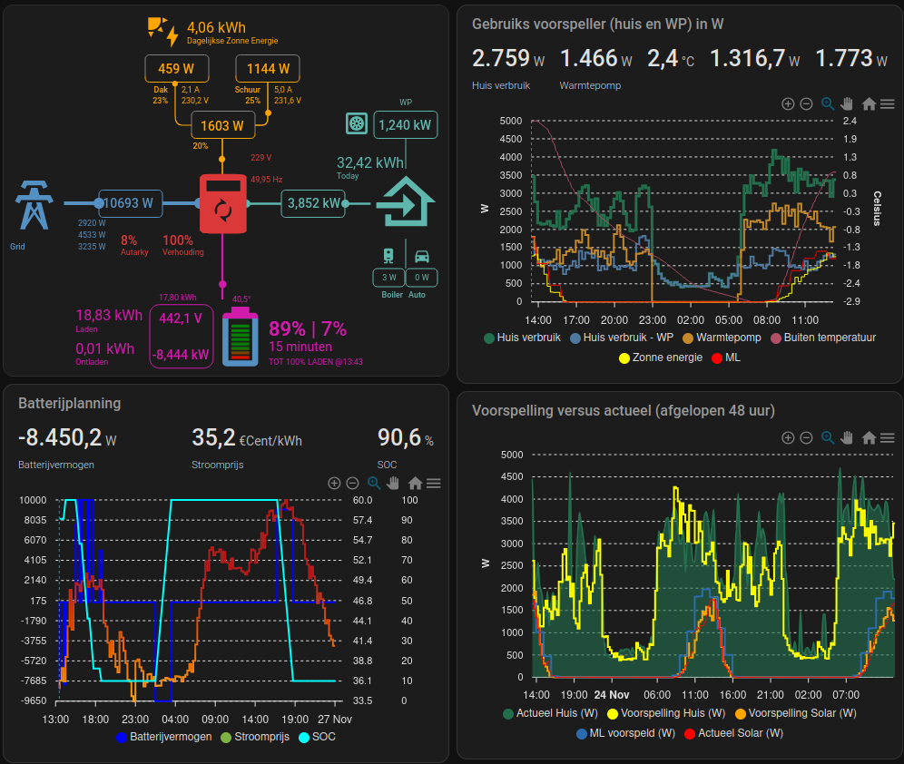

# Nexus Controller


A Home Assistant integration that runs a Zonneplan Nexus home battery (modified Solis S6-EH3P10K-H-ZP inverter) with its own energy management strategy: self-consumption (NOM, "nul op de meter") with a PID loop, plus price-based grid charging and selling on dynamic tariffs.

> **This software writes to a battery inverter.** Battery control is **off by default** on a fresh install; after a restart the previous choice is restored, but the inverter is never touched at startup until its power state is known, and the integration stays idle while the inverter is already off. Read the [safety section](#safety-mechanisms) first, start with control off, and keep the Zonneplan dongles connected until you trust it.

## What it does

- Keeps the grid meter near zero when it pays off (NOM), discharging against house load and charging from PV surplus.
- Plans per 15-minute quarter over the whole price forecast (a dynamic program plus a peak-first greedy search, best of both) and charges from the grid in cheap slots / sells in the dearest slots when the spread covers conversion losses and your desired earnings.
- Learns a 24 h solar production forecast and a 24 h household-demand (incl. heat pump) forecast from Recorder history, and uses them in the planner (see [docs/planner.md](docs/planner.md)).
- Tracks what the battery has earned, the value of the energy stored in it, and the number of cycles.
- Works with the Solis Modbus force charge/discharge switches and power numbers (`rc_force_battery_charge`, `rc_force_battery_discharge` and their power entities).
- Optionally powers down the inverter during suitable idle periods, with scheduled wake-up and battery-protection checks.

## Installation

In current Home Assistant versions **Marketplace** is part of the **Settings** menu; in earlier versions it was a sidebar entry called **HACS** — the steps are the same. The repository is not in the default catalog, so add it as a custom repository:

1. Open **Settings → Marketplace** (older versions: sidebar entry **HACS**), menu, **Custom repositories**.
2. Add `https://github.com/HMeuleman/Nexus_Controller`, type **Integration**.
3. Install **Nexus Controller** and restart Home Assistant.
4. Add it under **Settings > Devices & services > Add integration**.

## Setup

The setup dialog maps existing entities (each only once):

| Input | Notes |
| --- | --- |
| Grid power L1, L2, L3 | W, positive is import, negative is export |
| Battery state of charge | % |
| Electricity price | EUR/kWh including tax |
| Solis charge/discharge switches and power numbers | The four control entities |
| Fuse limit per phase | Default 25 A |
| Solar power (up to three, optional) | W or kW; `unknown` counts as 0 |
| Price forecast (optional) | Defaults to the `forecast` attribute of the price sensor. The Zonneplan quarter-hour tariff sensor is recommended: it also carries `price_tax_excluded`, so the exact tax per slot is known |
| Net battery power (optional) | W or kW, positive is discharging, negative is charging. Required for control, shadow proposals, the earnings tracker and powersave |
| Solar forecast (optional) | Expected remaining solar energy in kWh until sunset (the coming day at night) |
| Solar ML hourly forecasts (optional) | Separate sensors for today and tomorrow; used by the planner unless the ML-planner switch is off (see below) |
| House power / heat-pump power / outdoor temperature / weather forecast (optional) | Inputs for the learned consumption forecast; see [Diagnostic Consumption Forecast](#diagnostic-consumption-forecast) |
| Exclude entities (up to three, optional) | Additional sensors subtracted from the house power before learning |
| Inverter power switch (optional) | Select the actual inverter on/off switch to make powersave available; it is never auto-detected |

Everything else is a Home Assistant entity (see below), so you can change it without reloading.

## Entities

Settings (configuration entities, values survive restarts):

| Entity | Default | Meaning |
| --- | --- | --- |
| Reserved room per phase | 500 W | Headroom kept free on each phase |
| Max price for charging from grid | 0.15 | Legacy strategy: charge at or below this price (set to -1 to disable) |
| Minimum price for covering house load (floor) | 0.00 | Lower bound for the NOM discharge threshold |
| Minimum desired earnings per kWh | 0.10 | Wear included; also the planner's per-cycle / per-peak margin |
| Tax per kWh (fallback) | 0.11 | Used when the forecast does not provide the tax |
| Minimum SOC to allow discharge | 10 % | 7 to 99 |
| Control offset | 50 W | Shifts the PID setpoint: slight export when discharging, slight import when charging |
| Minimum power to control | 200 W | Below this the PID does nothing; also the floor for the two NOM planner thresholds below |
| Minimum predicted solar surplus for NOM charging | 0 W | Planner only: a slot may use solar (NOM) charging only when predicted solar minus predicted house demand strictly exceeds `max(this, minimum power to control)`; 0–5000 W, step 50 |
| Minimum predicted house demand for NOM discharge | 0 W | Planner only: below the export reserve a slot may use NOM discharge only when the predicted house demand strictly exceeds `max(this, minimum power to control)`; 0–5000 W, step 50 |
| Idle time before reversing direction | 75 s | 75 to 600 s; always longer than the 60 s keepalive interval |
| Solar production above which discharge is blocked | 10000 W | 0 blocks discharge as soon as there is any PV output |
| PID gains and deadbands | kp 0.5, ki 0, kd 0, 15/8 W | kp is defined at 10 s samples |
| Write-down: hours / minimum SOC / percent per day | 24 h, 50 %, 33 % | 0 percent turns it off |
| Manual override timeout | 30 min | See manual override |
| Inverter powersave cooldown | 10 min | Wait after startup, power-on, battery activity or unavailable inputs |
| Inverter powersave wake lead | 5 min | Wake before planned charging or discharging |
| Inverter maintenance interval / duration | 24 h / 30 min | Periodic continuous power-on period |
| Inverter powersave minimum SOC | 8 % | Keep inverter on at or below this SOC |

Controls (switches): **Battery control enabled**, **Planner**, **Use ML solar hourly forecast in planner**, **Exported energy paid including tax**, **Inverter powersave**, **Manual maximum charge** and **Manual maximum discharge**. Battery control is off on a fresh install; after a restart the previous choice is restored (the inverter itself is not touched at startup until its power state is known, and the integration stays idle while the inverter is already off). The planner selector starts on and is restored after a restart. The ML-planner switch starts on (planner uses the ML hourly forecast; off = the internal learned forecast, while both are still recorded). "Exported energy paid including tax" is on for the 2026 rules, off from 2027. Powersave starts off until explicitly enabled and then restores that choice after a restart.

Tracked values you can overwrite: **Battery earned total**, **Battery cycles total**, **Value of stored energy**.

Diagnostics: tax-free price, tax used, price from which the battery covers house load, battery cycles today, earned today, detected grid sample interval, expected solar surplus, safe charge/discharge power limits, price forecast statistics, the shadow proposal (mode, power, reason) and the control mode, power and status. Solar forecasts: the learned 24 h internal forecast (**Solar forecast next 24 hours**, kWh, with `slots`), the current-quarter predictions **Solar forecast now** (internal, W) and **Solar forecast ML now** (ML, W) — both recorded in history regardless of the planner source switch. The **Quarter-hour plan** sensor carries the full plan: metadata (`generated_at`, `estimated_profit_eur`, `minimum_earnings_eur_kwh`, `planner_strategy` = `dp` or `greedy`, `solar_source` = `ml`/`internal`/`none`, the NOM thresholds, `solar_included`, `planning_power_limit_w`, `limitations`, …) and `slots[]` with per-quarter `start`, `duration_hours`, `price_eur_kwh`, `export_tax_eur_kwh`, `power_w`, `charge_source`, `discharge_mode`, `action` (`idle`/`charge`/`nom_charge`/`discharge`/`nom_discharge`), `soc_pct`, `solar_forecast_kwh`, `demand_forecast_w` and `surplus_forecast_w`. Planner input failures and powersave measurement lockouts include per-entity state and report age in the Home Assistant logs.

## How the algorithm works

### Prices and tax

Every price slot has a tax: the difference between `price_tax_included` and `price_tax_excluded` when the forecast offers it, otherwise the configured fallback. The price excluding tax is shown as a sensor. Selling to the grid is valued at the price minus tax (from 2027), or at the full price when "exported energy paid including tax" is on (2026).

### The value of stored energy

The integration keeps a running cost basis for the energy in the battery. Charging from the grid adds energy at the import price, charging from PV adds it at the price it could have been exported for, and conversion losses are included. Discharging books the energy at what it saved or sold for, minus its cost basis; that is the "earned" figure. Charge cycles count every percent of SOC gained as 0.01 cycle.

### Decisions

When the planner is off, each time the grid meter reports, the existing strategy decides, in this order:

1. **Sell to the grid.** If the price after export tax beats the stored value plus the desired earnings, and the battery is above its export reserve, it discharges at maximum power, but only in the dearest slots that the available energy can cover. If a dearer slot is coming that the energy can still cover, it waits for it. When export is paid including tax, the export reserve is the configured minimum SOC; otherwise it is the higher of 30 % and the minimum SOC.
2. **Cover house load (NOM).** If the price reaches the discharge threshold, `stored value + desired earnings` (never below the floor setting), the house imports power and SOC is above the minimum, the PID discharges to bring the meter to zero. The threshold follows what the energy actually cost, so cheap stored energy is spent earlier and expensive stored energy is not sold at a loss.
3. **Charge from PV surplus.** When the house exports and the battery is not full, the PID charges to absorb the surplus.
4. **Charge at a low price.** At or below the maximum charging price it charges at the permitted maximum.
5. **Charge from the grid for later.** The cheapest slots in the known forecast are paired with the dearest later slots. A pair is used when the dear price times the round-trip efficiency, minus the cheap price, still earns the desired amount. The planner chooses how many slots and at what power the total profit is highest. Expected solar surplus (from the solar forecast minus the predicted house consumption over the remaining daylight) is subtracted from what is bought, and the dear side is valued as the better of use in the house or export.

Charging and discharging both use a fixed assumed efficiency of 97 % (94.09 % round trip), independent of power or whether charging is from grid or PV. This is an estimate, not a measured value.

### Quarter-hour planner

The planner estimates SOC, power and earnings across the available 15-minute prices. It runs **two candidate searches and keeps the more profitable one** (reported as `planner_strategy` in the plan metadata):

- a **dynamic program** over contiguous charge/discharge cycles with bounded inventory levels, and
- a **peak-first greedy search** that tracks up to three local price maxima; each peak is discharged at its highest-priced slots and sourced from the cheapest charge slots anywhere earlier in the forecast (several charge moments per peak and one charge feeding several peaks are both possible).

Both apply the desired earnings threshold per cycle/peak, value solar charging at the forgone export price, and respect the export reserve: with tax-inclusive export the minimum SOC is also the export limit, otherwise export stops at the higher of 30 % and the minimum SOC. NOM behaviour is planned per slot from the **predicted house demand** (the learned consumption forecast): below the export reserve discharge is capped at predicted demand minus solar, and gated off where the predicted demand does not exceed the NOM-discharge threshold; solar (NOM) charging is gated by the predicted surplus against the NOM-charge threshold. Without a demand prediction for a slot the NOM gates stay off for that slot. The planner's solar input is the ML hourly forecast by default, or the internal learned 24 h forecast when the ML-planner switch is off (`solar_source` in the metadata says which was used); missing solar hours cause the planner to omit solar entirely and report `solar_included: false`.

A charge block whose target is 100 % or a discharge block whose target is the minimum SOC runs its **last quarter at the full 10 kW** (energy-preserving within the block), so the inverter/BMS cutoff does the fine-tuning and the goal is reached despite phase limits and efficiency deviations.

The forecast uses the 10 kW battery power limit rather than today's temporary phase limits. The plan exposes this assumption as `planning_power_limit_w`. Live phase limits still cap every actual charge or discharge command, and the remaining energy in a retained current quarter is projected using its relevant live limit. If that limit is unavailable for an active commitment, the plan is unavailable until it can be projected safely. A persistent phase limit can prevent the battery from reaching the forecast SOC or earnings.

When actual SOC is below the discharge minimum, the plan starts at the measured SOC. A profitable charge/discharge cycle must first charge enough to restore the minimum and retains that energy; planning does not itself force a recovery charge. Live discharge remains blocked at or below the minimum.

Configure the same quarter-hour tariff sensor as both the current electricity price and price forecast, and inspect **Quarter-hour plan** first. Then, only if you choose to control the inverter, turn on **Battery control enabled**. The planner selector alone never enables control. Switching the planner off returns to the existing strategy; manual overrides keep priority.

When the plan or required readings are stale, a price or tax differs from the plan, or the current price does not match the quarter forecast, planner control stops rather than falling back to the existing strategy. `Control: status` reports `planner_price_mismatch` when the selected current price differs. An earnings change requests a new plan immediately; while it is calculating, only the matching committed current quarter can remain active, subject to all live checks. The planner watchdog can stop control even without a new P1 report. An actuator error also clears the planner selection.

Plans are estimates, not guaranteed maximum earnings: the DP uses contiguous cycles and bounded inventory levels, the greedy candidate tracks at most three peaks, house load uses the per-slot demand forecast (NOM gates stay off where the prediction is missing), and efficiency is fixed at 97 % per direction. Missing solar hours cause the planner to omit the entire solar forecast and report `solar_included: false`. The first calculation starts after settings have been restored; an unavailable plan is retried at most every 30 seconds. Successful plans are recalculated in the background at most once every five minutes, and once when the planner is enabled or a planner-relevant setting changes. If a calculation is already running, the requested recalculation waits for it to finish. A computation that exceeds its work limit is unavailable. After the first plan, recalculation retains the active quarter's planned action and projects its remaining effect on SOC before optimizing later quarters using current settings. A changed current price or tax makes the plan unavailable until its assumptions match again or the quarter ends. The displayed profit excludes a retained current quarter. Actual SOC, phase caps and other safety checks still apply before each command.

See [docs/planner.md](docs/planner.md) for the full technical description of the planner, its parameters, entities and feature history.

### Inverter powersave

Select the actual inverter power switch and configure the net battery power sensor first. Powersave is off by default and must be explicitly enabled; selecting the planner does not enable it. Once enabled, the setting is restored after restart and the integration requests that the inverter be on at startup. Battery control still starts off. Powersave only switches the inverter off while both planner and battery control are enabled, a fresh valid plan covers the idle period, the SOC and battery power readings are fresh, battery power is exactly zero and both forced-mode switches are confirmed off. A manual override keeps it on.

The inverter stays on for the configured cooldown after startup, a confirmed power-on or any nonzero battery power. Missing or stale readings and unavailable plans restart the cooldown, so inputs must remain healthy for that period before another shutdown. The inverter wakes before planned work and never deliberately starts an off period shorter than 15 minutes; a safety condition or changed schedule can require an earlier wake-up. The inverter is kept on at or below the powersave minimum SOC, and the integration requests a continuous power-on period for the configured maintenance duration once per maintenance interval. It waits at least one minute after confirmed power-on before issuing charge or discharge commands. Missing or stale readings, an unavailable or changed plan, disabled control or planner, and invalid settings request power on. The **Inverter powersave status** sensor reports the decision or a failed write.

If required measurements become unavailable while the inverter is off following an automatic powersave shutdown, the integration requests power on and disables powersave to avoid repeated power cycles. The status reports `measurements_lockout`; investigate the readings before explicitly enabling powersave again. A failed wake request remains a safety issue and is reported as `inverter_write_failed`.

In **Developer Tools > States**, select **Inverter powersave status** to inspect its state and attributes:

| Attribute | Meaning |
| --- | --- |
| `configured` / `enabled` | Whether an inverter switch is selected and powersave is enabled |
| `inverter_power` / `requested_power` | Observed switch state and the requested state; a request is not confirmation of a successful write |
| `measurements_fresh` | Whether the required readings are recent enough for powersave decisions |
| `measurement_max_age_s` | Maximum report age currently accepted; at least 120 s or three sample intervals. L1/L2/L3 share freshness: any one recent report is the group heartbeat, while all three values must be valid |
| `measurements` | Each configured phase, SOC and battery power entity's state, report age and freshness |
| `measurement_lockout` | Whether powersave was disabled because measurements were lost after an automatic shutdown |
| `inverter_on_since` | When the inverter was observed to turn on |
| `last_unavailable_at` | Most recent observation of unavailable measurements, an unavailable plan or insufficient plan coverage |
| `cooldown_until` | Earliest end of the startup or last-activity cooldown |
| `control_ready_at` | End of the one-minute power-on wait before charge/discharge control |
| `next_planned_work_at` / `planned_wake_at` | Next planned charge/discharge and its calculated early wake time |
| `maintenance_start_at` | Calculated start of the next maintenance power-on period |

Times are UTC estimates and may change with the plan, measurements or settings. An unavailable schedule has no planned-work or wake time. Ending the cooldown does not guarantee shutdown: all safety checks and the minimum idle window must still be satisfied. Timing attributes are not stored in Recorder history.

For example, `cooldown` means the waiting period is still active, `battery_active` means battery power is nonzero, and `low_soc` keeps the inverter on. `plan_unavailable` or `measurements_unavailable` indicates that a safe shutdown cannot be planned; `inverter_write_failed` means a switch command failed.

The powersave implementation is tested offline only. A running Home Assistant, working Modbus connection and correct sensor reports are required; the integration cannot guarantee a wake-up or the maintenance interval during an outage or failed write. Verify the switch and readings and monitor the inverter closely before relying on powersave.

### The PID loop

NOM and PV surplus use an incremental PID on the measured net power: the new power is the measured battery power plus `kp x error` (plus integral and derivative terms if configured). The integration measures how often the meter reports and scales the proportional step for faster meters, so a 1 s meter and a 30 s meter both settle. Extra rules keep it calm:

- Start and stop deadbands prevent hunting around zero; inside the deadband it holds the current power.
- If it overshoots it eases off instead of dropping to zero.
- Below the minimum control power (measured on the house load without the battery) it does not regulate at all.
- The control offset shifts the setpoint, which compensates for a constant measurement bias.
- The proposed power is clamped by the per-phase limits: for each phase the fuse capacity minus the reserved room, using the load without the battery, over three phases and a 10 kW cap.

### Stored value write-down

If the battery stays above the configured SOC and does not discharge for the configured hours (for example after a crash during a planned cycle), the stored value is marked down towards the market: the higher of the running average price and the mean of the dearest forecast slots, by a percentage of the gap per day. It never goes up this way, stops when the battery discharges again, and creates a notification when it starts.

## Safety mechanisms

- **Control is off by default** on a fresh install; after a restart the previous choice is restored, but the inverter is never written at startup until its power state has been read, and the integration stays idle while the inverter is already off. Turning control off, an error, or unloading the integration writes zero to the configured power setpoints, then clears force mode.
- **Write sequence:** both modes off, power set, then the mode on, rate limited.
- **Keepalive:** on a control update after 60 s, the active Solis force-charge/discharge service is refreshed with the latest Nexus power target, without an off/on toggle. If the inverter drops the mode on its own, the same service reasserts the mode and target.
- **Idle time between directions:** the battery goes idle for at least 75 s before it may reverse, even if a lower delay was previously stored.
- **Limits:** minimum SOC, 100 % maximum, per-phase headroom and the 10 kW cap also apply to the manual override.
- **Unit check:** the power numbers are read for their unit (W or kW) and limits before writing; other units stop the control.

## Manual override

Set the timeout, then turn on **Manual maximum charge** or **Manual maximum discharge** (they exclude each other). The battery runs at the maximum safe power until the timeout, the SOC limit, or you turn it off. It works with automatic control off, and is always off after a restart.

## Tuning tips

- Start with control off and watch the shadow proposal sensors for a few days.
- If the grid import settles at a constant value while discharging, raise the control offset; check the step attribute of the Solis power number (a step of 100 W hides small corrections).
- For faster settling raise `kp` (try 0.7) and use a small `ki` (0.005).

## Simulation tools

The `sim/` directory has offline tools used to choose the defaults from real Home Assistant history: `build_trace.py` turns a history export into a trace, `closed_loop.py` simulates the strategy against the reconstructed load without the battery, and `replay.py` replays decisions without a plant model. They never talk to Home Assistant.

The diagnostic **Quarter-hour plan** exposes a `slots` attribute with timestamps, prices, estimated power (positive is discharge), charge source and end-of-slot SOC. It is separate from the existing shadow proposal; it controls the battery only when the planner and battery control switches are both on. It requires a contiguous 15-minute price forecast and uses only the remaining duration of the current slot when that slot is available.

In Home Assistant, open the diagnostic sensor's attributes to inspect its plan and estimated profit. A custom forecast-capable dashboard card, such as ApexCharts Card, can plot the `slots` attribute as price, planned power and SOC series. The ordinary history graph cannot show these future values directly.

An [example ApexCharts card](dashboard_planner.yaml) is included. Replace its example entity ID with the actual quarter-hour plan sensor ID from your Home Assistant installation. Because each slot now also carries an `action` label, the card can color the plan by action, e.g. `slots.filter(s => s.action === 'nom_discharge').map(s => [new Date(s.start).getTime(), s.power_w])` in a `data_generator`.

Two kinds of solar forecast are available. The optional ML hourly inputs can be selected explicitly for today's Solar Forecast ML hybrid forecast and tomorrow's Solar Forecast ML forecast; each hourly kWh value is divided evenly across its four quarters as `solar_forecast_kwh` in the plan. Independently, the integration learns its own 24 h forecast from Recorder history (per-quarter means over a retained seven-day window, with a per-hour weather-ratio correction from the weather forecast), exposed as **Solar forecast next 24 hours** (`slots` with per-quarter `pv_w`) and **Solar forecast now** (W). **Solar forecast ML now** (W) records the ML prediction for the current quarter whenever the ML entities are configured — both now-sensors are recorded regardless of which source the planner uses. The planner uses the ML forecast when the **Use ML solar hourly forecast in planner** switch is on (default) and the learned internal forecast otherwise; `solar_source` in the plan metadata shows which was used. When the selected forecast does not cover every planned quarter, the planner leaves solar out and reports `solar_included: false`; missing hours are not treated as zero.

Solar-only charging is considered only when paired with a profitable discharge within the forecast. Missing forecast taxes use the configured fallback. The `slots` attribute is not stored in Recorder history.

## Diagnostic Consumption Forecast

Select the optional household power sensor, heat-pump electrical power sensor,
hourly forecast weather entity, and outdoor temperature sensor in the integration's
configuration. The power sensor must report the electric power of the house
(W/kW); it must include heat-pump use but exclude battery charging. Units are
read from the selected entities; IDs are never auto-selected. Weather is
requested through `weather.get_forecasts` in the background every 15 minutes;
cached forecasts expire after two hours.

The **Consumption forecast next 24 hours** and **Heat-pump forecast next 24 hours** sensors
expose kWh totals plus 96 timestamped `slots` with `baseline_w`, `heatpump_w`, `total_w`,
`temperature_c`, and `history_days`. Three additional sensors record the moment-by-moment
view in the Recorder, so Home Assistant history shows the past days: **Consumption
forecast now** (W, the slot forecast as it stood at each moment; 0 while the baseline is
still learning), **Temperature forecast** (°C, interpolated from the weather forecast)
and **Actual temperature** (°C, from the outdoor temperature sensor when configured,
otherwise the weather entity's current reading). The live controller does not use them,
but the **quarter-hour planner does**: the per-slot `total_w` forecast drives the NOM
charge/discharge gates and the per-slot discharge cap in planning (exposed per plan slot as
`demand_forecast_w` and `surplus_forecast_w`).

The forecast is learned entirely from measurements; there is no fixed heat-pump
curve or schedule and no blind learning period. Each local quarter of the day
keeps its own seven-day time-weighted mean for the household (heat-pump power
subtracted before averaging) and, when a heat-pump sensor is configured, for the
heat pump itself — so a morning ramp or a night with the heat pump off is picked
up from the data, not assumed. Quarters with too little fresh coverage, negative
household readings, unavailable readings, or heat-pump power above the household
power are discarded; ambiguous autumn DST quarters are excluded from learning
while the forecast itself uses real UTC quarter steps.

At every integration start the retained seven-day window is rebuilt from Home
Assistant Recorder statistics (five-minute means of the configured sensors), so
the forecast works immediately: as soon as Recorder holds at least three observed
days per quarter (a default install does), the sensors show a full forecast
instead of zeros. The stored profile is versioned; older formats are discarded
rather than bridged. When the optional outdoor temperature sensor is configured,
its per-quarter readings are retained as well and drive the temperature
correction: for each quarter a slope is fitted from the retained days (at least
three paired days and enough temperature variance), the predicted hourly
temperature is applied to it, and the result is clamped to a factor of three
around the learned mean so a noisy fit cannot invent absurd demand. Without an
outdoor temperature sensor the plain seven-day means are used.

An [ApexCharts card YAML](dashboard_demand.yaml) plots baseline, heat pump, total demand,
and temperature. A second [example card](dashboard_history.yaml) shows the past 48 hours
with the forecast as it was made over time, the actual house power, and both the forecast
and actual outside temperature; it relies on the three recorded now-sensors and the
configured house power sensor. Install ApexCharts Card through HACS and replace the
placeholder entity references with the real entity IDs.
Missing values remain `null`, not zero. The normal history graph
cannot plot future timestamps. `slots` is excluded from Recorder; graph data comes
from the sensor's current attributes. The status attribute is `partial` until every
quarter has baseline and weather coverage, then `ready`.

## Development

Python 3.12 or newer:

```powershell
py -3.12 -m venv .venv
.\.venv\Scripts\Activate.ps1
python -m pip install -e ".[dev]"
python -m pytest tests/ -q
python -m ruff check .
```

(On Windows Git Bash the same calls are `./.venv/Scripts/python.exe -m pytest tests/ -q` and `./.venv/Scripts/python.exe -m ruff check .`.)

To try it locally, copy `custom_components/nexus_controller` into your Home Assistant `custom_components` directory and restart.

The planner's design, parameters, exposed plan fields and feature history are documented in [docs/planner.md](docs/planner.md). Releases are tagged `vX.Y.Z` on GitHub; the version lives in both `custom_components/nexus_controller/manifest.json` and `pyproject.toml`.

## Issues

Report problems or suggestions in the [GitHub issue tracker](https://github.com/HMeuleman/Nexus_Controller/issues).

## Voorbeeld (Nederlands)

Zo ziet een Home Assistant-dashboard eruit waarop de Nexus Controller integratie actief is:



*Voorbeeld screenshot van de actieve Nexus Controller integratie: linksboven het energieschema met grid, omvormer en batterij; rechtsboven de verbruiksvoorspeller (huis en warmtepomp); linksonder de batterijplanning met stroomprijs en SOC; rechtsonder de voorspelling versus het werkelijke verbruik van de afgelopen 48 uur.*

<!-- TODO (Nederlands): beschrijf hier welke sensoren je bij Setup moet configureren en waarvoor elke sensor precies dient, met extra screenshots. -->
